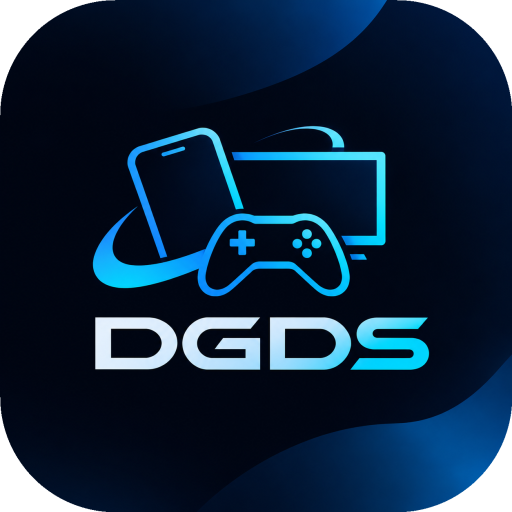

# DGDS

**Mira la pantalla de tu teléfono Android en tu PC, sin instalar nada en la PC.**

Pensado para computadoras modestas: el juego o la app corre en tu teléfono, y la PC
solo muestra la imagen en el navegador (Chrome, Edge o Firefox). No necesita cuenta,
no tiene publicidad y es gratis y de código abierto.

## Descargar la app
### [**Descargar DGDS para Android (APK)**](https://github.com/cristhiandalmauquintana-ctrl/Double-Gaming-Device-System/releases)

Se abre la página de la versión más reciente. Baja hasta la sección **Assets** y toca el
archivo que termina en **`.apk`**. Ignora los archivos "Source code": son para programadores.

> **Estado: beta temprana.** Ya puedes ver la pantalla del teléfono en el navegador.
> Los controles desde la PC, el audio y otras funciones están en camino (ver más abajo).

## Qué necesitas
- Un teléfono **Android 10 o más nuevo**.
- Una PC o laptop con navegador, de cualquier sistema (Windows, Linux, ChromeOS, macOS).
- El teléfono y la PC en la **misma red Wi-Fi**. Si tu red no sirve, también puedes
  activar el *punto de acceso* del teléfono y conectar la PC a él.

## Instalar en el teléfono
1. Desde el teléfono, entra en la [página de descargas](https://github.com/cristhiandalmauquintana-ctrl/Double-Gaming-Device-System/releases) y baja el archivo `.apk`.
2. Ábrelo desde las notificaciones o desde la carpeta **Descargas**.
3. Android te pedirá permitir instalar apps de este origen: acepta. Es normal, porque la
   app todavía no está en la tienda de Google Play, y puede mostrar una advertencia de seguridad.
4. Termina la instalación y abre **DGDS**.

## Usar
1. Abre **DGDS** en el teléfono y toca **Iniciar transmisión**. Acepta el permiso de captura de pantalla.
2. La app te muestra una dirección parecida a `http://192.168.1.50:8080`.
3. Escribe esa dirección en el navegador de tu PC.
4. Listo: verás tu pantalla. Usa **Pantalla completa** para verla en grande.

Para terminar, toca **Detener transmisión** en el teléfono.

> Puedes girar el teléfono cuando quieras: la imagen se adapta sola.

## Si algo no funciona
- **La app dice que el teléfono no está en una red Wi-Fi:** conecta el teléfono al mismo Wi-Fi que la PC. Los datos móviles no sirven.
- **La página no carga en la PC:** comprueba que ambos están en la misma red y que escribiste la dirección completa, con `http://` y el número final. Algunas redes (hoteles, escuelas, redes de invitados) impiden que los dispositivos se vean entre sí; prueba con el punto de acceso del teléfono. Si usas VPN, desactívala.
- **Se ve negro:** algunos juegos y apps bloquean la captura de pantalla y Android no lo permite.
- **Va lento o se corta:** acerca ambos dispositivos al router y usa Wi-Fi de 5 GHz si puedes. En esta beta, el video ocupa bastante red y procesador del teléfono.
- **El teléfono se calienta:** es normal al jugar y transmitir a la vez. Conviene cargarlo mientras tanto.
- **Se quedó congelado:** pulsa **Reconectar** en la página.

¿Sigue sin funcionar? Cuéntanoslo en [Problemas](https://github.com/cristhiandalmauquintana-ctrl/Double-Gaming-Device-System/issues) indicando el modelo de tu teléfono y qué ves.

## Qué funciona hoy y qué viene
**Hoy:** ver la pantalla del teléfono en el navegador de la PC por Wi-Fi.

**En camino:**
- Controlar el juego con el teclado, el mouse o un mando conectado a la PC.
- Menos retraso y menos consumo de red (video H.264).
- Conexión por cable USB-C.
- Audio.
- Pantalla del teléfono oscura mientras transmites, para ahorrar batería.
- Guía para enviar la imagen a una TV.

## Privacidad y seguridad
- No hay cuentas ni publicidad, y la app no envía datos a internet: todo viaja dentro de tu red local.
- Android muestra un aviso mientras se captura la pantalla.
- Por ahora **no hay contraseña**: cualquiera en tu misma red que conozca la dirección podría ver tu pantalla.
  Úsala solo en redes de confianza (tu casa), nunca en Wi-Fi públicos.

## Colaborar
DGDS es de todos. Si quieres ayudar con código, traducciones o guías, mira
[docs/DESARROLLO.md](docs/DESARROLLO.md).

## Licencia
[Apache 2.0](LICENSE): libre para usar, modificar y compartir.
